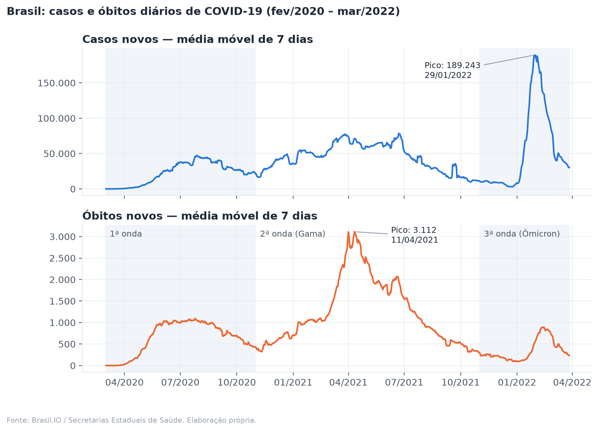

# COVID-19 no Brasil (2020–2022): análise exploratória com Python sob princípios FAIR

[](https://enzortorres.github.io/projeto_casos_covid/)
[](https://www.python.org/)
[](https://pandas.pydata.org/)
[](LICENSE)
[](LICENSE-DATA.md)
[](LICENSE-DATA.md)
[](#princípios-fair)

| | |
|---|---|
| **Curso** | Bacharelado em Sistemas de Informação — 6º período |
| **Instituição** | [Nome da Instituição] |
| **Disciplina** | Linguagem de Programação — Análise e Visualização de Dados com Python |
| **Professor** | Alexandre Neves Louzada |
| **Autor** | Enzo Ribas Torres |
| **Semestre** | 2026.2 |
| **Artigo (GitHub Pages)** | <https://enzortorres.github.io/projeto_casos_covid/> |
| **Fonte dos dados** | [Brasil.IO — `caso_full`](https://brasil.io/dataset/covid19/caso_full/) |

**Palavras-chave:** COVID-19; Epidemiologia Descritiva; Análise Exploratória de Dados; Python; Visualização de Dados; Princípios FAIR.

---

## Resumo executivo

Este projeto analisa **3,85 milhões de registros diários** dos boletins de COVID-19 das 27 Secretarias Estaduais de
Saúde, consolidados pelo Brasil.IO, de **25/02/2020 a 27/03/2022**. São 5.570 municípios, 29,8 milhões de casos e
659 mil óbitos notificados. Um pipeline determinístico em Python valida, limpa, enriquece e persiste os dados em
formatos abertos. Os resultados estão em um artigo acadêmico em HTML publicado no GitHub Pages.

### Perguntas de pesquisa

1. **RQ1.** Como evoluíram os casos e óbitos diários no Brasil, quantas ondas se distinguem e como variou a letalidade aparente entre elas?
2. **RQ2.** Como a incidência, a mortalidade e a letalidade acumuladas se distribuíram entre UFs e regiões, e essas medidas caminham juntas?
3. **RQ3.** O porte populacional do município está associado à mortalidade e à letalidade acumuladas?

### Principais achados

| Indicador | Valor |
|---|---|
| Óbitos notificados (até 27/03/2022) | **659.159** (311,3 por 100 mil hab.) |
| Onda mais letal | **2ª (Gama)**: 68% dos óbitos; pico de 3.112 óbitos/dia em 11/04/2021 |
| Maior pico de casos | **3ª (Ômicron)**: 189.243 casos/dia em 29/01/2022, com letalidade de 0,64% |
| Maior / menor mortalidade por UF | **MT** 421,2 / **MA** 152,8 por 100 mil (2,8×) |
| Incidência × letalidade (UFs) | **ρ = −0,74**: a letalidade aparente reflete a capacidade de testagem |
| Mortalidade mediana por porte | de **174** (até 20 mil hab.) a **317** por 100 mil (mais de 500 mil hab.) |



---

## Estrutura do repositório

```
projeto_casos_covid/
├── README.md                    # Este arquivo
├── LICENSE                      # MIT (código)
├── LICENSE-DATA.md              # CC BY 4.0 (texto) e CC BY-SA 4.0 (dados derivados)
├── requirements.txt             # Dependências congeladas (pip freeze)
├── .gitignore / .gitattributes
│
├── data/
│   ├── raw/                     # Bruto não versionado (92 MB). Ver data/raw/README.md
│   ├── processed/               # Tabelas tratadas (.parquet e .csv.gz) e relatorio_qualidade.json
│   └── data_dictionary.md       # Metadados e dicionário de variáveis
│
├── notebooks/
│   └── analise_exploratoria.ipynb   # Exploração, validação e prototipação (executado)
│
├── src/
│   ├── __init__.py
│   ├── etl.py                   # Download, leitura tipada, validação, limpeza e tabelas analíticas
│   └── viz.py                   # Figuras estáticas (PNG) e interativas (Plotly/HTML)
│
└── docs/                        # GitHub Pages
    ├── index.html               # Artigo científico
    └── assets/                  # Figuras (fig1…fig6 em .html e .png)
```

## Como reproduzir

Pré-requisitos: Python 3.12 e Git. Nenhuma credencial é necessária.

```bash
git clone https://github.com/enzortorres/projeto_casos_covid.git
cd projeto_casos_covid

python -m venv .venv
# Windows (PowerShell):
.venv\Scripts\Activate.ps1
# Linux/macOS:
source .venv/bin/activate

pip install -r requirements.txt

python -m src.etl      # baixa data/raw/caso_full.csv.gz (se ausente) e gera data/processed/
python -m src.viz      # gera docs/assets/fig*.html e fig*.png
```

Para explorar o notebook: `jupyter lab notebooks/analise_exploratoria.ipynb`.
Para ver o artigo localmente, abra `docs/index.html` no navegador.

O pipeline leva cerca de 15 s (sem contar o download) e é determinístico: as mesmas entradas geram as mesmas saídas.

## Pipeline de dados

| Etapa | Função (`src/etl.py`) | O que faz |
|---|---|---|
| Aquisição | `download_raw` | Baixa o CSV.gz via HTTPS do Brasil.IO, sem autenticação |
| Leitura | `load_raw` | UTF-8, separador `,`, tipos explícitos (`Int64`, `category`, `datetime64`) |
| Validação | `validate_raw` | Esquema (18 colunas), 27 UFs e zero duplicatas local × data. Gera o relatório de qualidade |
| Limpeza | `clean` | Renomeia para português, deriva região e cria *flags* (`e_correcao`, `e_importado_indefinido`) |
| Tabelas | `build_*` | `brasil_diario`, `uf_diario`, `uf_mensal`, `uf_resumo`, `municipios` |
| Persistência | `save` | Parquet (zstd) e CSV.gz para cada tabela, mais o JSON de qualidade |

**Decisões de tratamento** (nenhum dado bruto é descartado sem rastro):

- **Dupla granularidade:** totais por UF e Brasil usam só as linhas `place_type = state`, para não contar o mesmo caso duas vezes.
- **Registros repetidos** (26,4%): são dias sem boletim. Por isso as séries diárias usam média móvel de 7 dias.
- **Valores negativos** (38.638 em casos e 6.261 em óbitos): são correções retroativas. Ficam mantidos e sinalizados.
- **Importados/Indefinidos:** entram nos totais estaduais e saem da análise municipal, porque não têm população.
- **Séries municipais incompletas:** a atualização municipal termina entre ago/2021 e mar/2022, conforme a UF. A tabela `municipios` usa uma data de corte comum (22/08/2021) e guarda o último registro em colunas próprias.

Detalhes de cada variável em [`data/data_dictionary.md`](data/data_dictionary.md).

## Princípios FAIR

| Princípio | Como é atendido |
|---|---|
| **Findable** | README com resumo, palavras-chave e autoria; link perene para a fonte; artigo com metadados `<meta>` |
| **Accessible** | Repositório público; ingestão por HTTPS sem credenciais; artigo no GitHub Pages, responsivo |
| **Interoperable** | Parquet e CSV.gz (UTF-8, ISO 8601); dicionário de dados com tipo, unidade e regra de cada coluna |
| **Reusable** | MIT, CC BY 4.0 e CC BY-SA 4.0; `requirements.txt` congelado; pipeline determinístico; relatório de qualidade |

## Limitações

Casos confirmados dependem da testagem, por isso a letalidade é *aparente*. As séries usam a data de notificação. A
população é a estimativa fixa de 2020. A análise municipal vai até 22/08/2021. O desenho é ecológico.

## Como citar

> TORRES, Enzo Ribas. *COVID-19 no Brasil (2020–2022): análise exploratória com Python sob princípios FAIR*. 2026.
> Disponível em: <https://github.com/enzortorres/projeto_casos_covid>.

Fonte dos dados: BRASIL.IO. *COVID-19: boletins epidemiológicos das Secretarias Estaduais de Saúde*. Disponível em:
<https://brasil.io/dataset/covid19/caso_full/>. Licença CC BY-SA 4.0.
